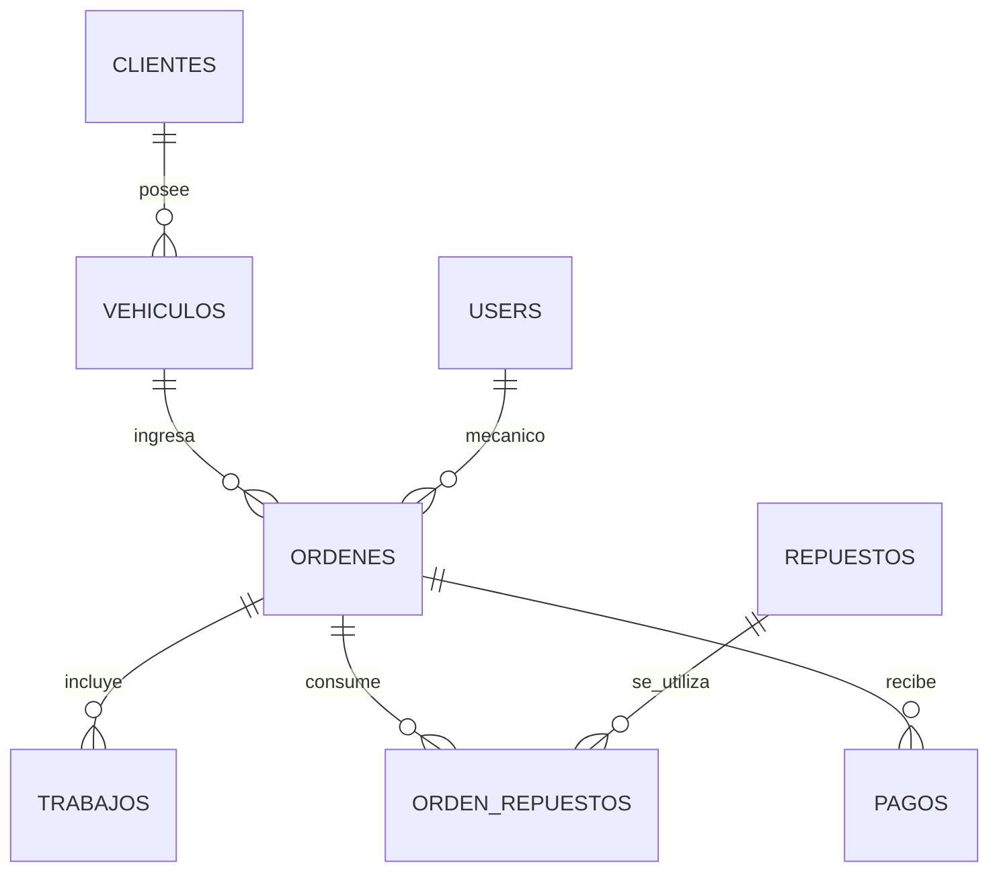

# Arquitectura de la solución

## Visión general

El Pistón consta de dos componentes ejecutados en la misma computadora:

```text
Navegador (http://127.0.0.1:5500)
│
├── client/index.html           Documento de entrada
├── client/css/styles.css       Componentes visuales y diseño adaptable
├── client/js/app.js            Rutas visuales, formularios y cálculos
└── client/vendor/pocketbase.es.mjs
     │  Peticiones HTTP al API de PocketBase
     ▼
PocketBase (http://127.0.0.1:8090)
├── Auth / API Rules
├── Colecciones y relaciones
├── API REST generada
└── SQLite (server/pb_data/)
```

El servidor Python utilizado en el puerto `5500` entrega archivos estáticos. La comunicación con la base de datos se realiza desde el navegador hacia PocketBase, utilizando su SDK.

## Organización del frontend

`client/js/app.js` concentra la lógica de presentación y acceso a datos. Sus áreas principales son:

- **Sesión:** `authWithPassword()`, `authRefresh()`, almacenamiento de sesión del SDK y cierre de sesión.
- **Carga de datos:** `fetchData()` utiliza `getFullList({ sort: '-created' })` para las colecciones accesibles por rol.
- **Estado de pantalla:** objeto `state`, navegación por `state.page`, filtros y selección de registros.
- **Vistas:** `dashboardPage`, `clientsPage`, `vehiclesPage`, `ordersPage`, `orderDetailPage`, `inventoryPage`, `paymentsPage` y `reportsPage`.
- **Formularios:** funciones `open*Form()` con modales y peticiones `create()` o `update()`.
- **Derivados:** `stockFor`, `laborFor`, `partsFor`, `paidFor`, `totalFor`, `balanceFor`.

Las páginas se renderizan dinámicamente desde JavaScript sobre el nodo `#app` de `index.html`. La navegación no requiere rutas adicionales en el servidor estático.

## Organización de PocketBase

- **`users` (Auth):** identidad y rol de los empleados.
- **Colecciones Base:** `clientes`, `vehiculos`, `ordenes`, `trabajos`, `repuestos`, `orden_repuestos`, `pagos`.
- **API Rules:** reglas por colección que definen la lectura, creación, modificación y borrado en función del usuario autenticado.
- **Migraciones JavaScript:** versión del esquema, índices, campos automáticos y ajustes de permisos.
- **SQLite:** almacenamiento administrado por PocketBase, dentro de `server/pb_data/`.

El proyecto no define rutas de negocio adicionales ni un backend intermedio: las operaciones se realizan mediante los endpoints que genera PocketBase.

## Relaciones del dominio



Un cliente puede tener varios vehículos, un vehículo puede contar con múltiples órdenes y cada orden puede tener múltiples líneas de trabajo, repuestos consumidos y abonos. Cada orden tiene **un mecánico asignado**.

## Decisiones de diseño

1. **Datos normalizados:** cliente, vehículo y orden están relacionados mediante IDs; el nombre del propietario no se duplica en cada orden.
2. **Registro histórico por visita:** se crea una orden por ingreso y se conserva `kilometraje_ingreso` aunque después cambie `kilometraje_ultimo` del vehículo.
3. **Precios históricos:** `trabajos.precio_centavos` y `orden_repuestos.precio_unitario_centavos` almacenan los importes propios de cada servicio.
4. **Montos como enteros:** el almacenamiento en centavos evita errores de redondeo propios de números de punto flotante al combinar importes.
5. **Stock calculado:** `repuestos.unidades_recibidas` acumula las entradas y `orden_repuestos` las salidas, sin mantener una segunda columna de existencias.
6. **Facturación y cobros independientes:** la facturación suma órdenes entregadas, mientras que los cobros provienen de la colección `pagos`.
7. **Acceso por roles:** el frontend muestra acciones según el rol y las API Rules definen las operaciones disponibles en cada colección.
8. **Migraciones versionadas:** una instalación limpia puede reconstruir esquema y permisos sin configurar manualmente cada campo.

## Puertos y despliegue local

| Puerto | Proceso | Dirección |
|---|---|---|
| 8090 | PocketBase | `http://127.0.0.1:8090` |
| 5500 | Python HTTP estático | `http://127.0.0.1:5500` |

La conexión del cliente se configura con `API_URL` en `client/js/app.js`. No se requiere una base de datos externa ni servicios remotos mientras la aplicación está en ejecución.

## Referencias internas

- [Esquema de datos](modelo-datos.md)
- [Contrato de API](api.md)
- [Autorización](permisos.md)
- [Operación del taller](operacion.md)
